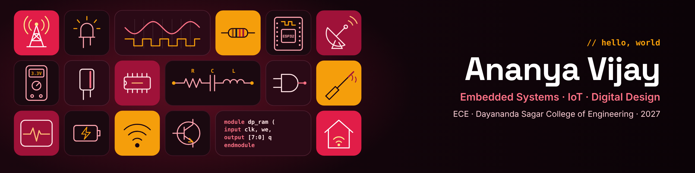

<!-- Still to fill in: YOUR-LINKEDIN, YOUR-EMAIL and each REPO-NAME. Upload banner.png to this repo too -->

  

<h1 align="center">Hi there, I'm Ananya Vijay 👋</h1>

  

---

### 🧑‍💻 About me

I'm a final-year **Electronics & Communication Engineering** student at **Dayananda Sagar College of Engineering**, Bengaluru (Class of 2027). I enjoy working where hardware meets code: microcontrollers, sensors and digital logic.

- 🔌 Currently working on **embedded systems, IoT and digital design**
- 📄 Published a research paper on **machine-learning-based blood group classification**
- 🎯 Looking for **internships in embedded systems, firmware, IoT and digital design**
- 💬 Ask me about **ESP32, Verilog, sensors and MATLAB**

---

### 🤝 Connect with me

  
  
  
  

---

### 🛠️ Tech stack

**🔧 Hardware & Embedded**

  
  
  
  

**🧮 Digital Design**

  
  

**📈 Programming & Analysis**

  
  
  
  

---

### 🚀 Featured projects

| Project | What it does | Built with |
|---|---|---|
| [**ESP32 Smart Home Automation**](https://github.com/ananyavijay0727/REPO-NAME) | Controls home appliances over Wi-Fi with an ESP32 | ESP32 · Embedded C · IoT |
| [**Dual Port RAM**](https://github.com/ananyavijay0727/REPO-NAME) | Dual-port memory designed and simulated in Verilog | Verilog · Quartus Prime |
| [**Fractional-Order Bioimpedance Sensor**](https://github.com/ananyavijay0727/REPO-NAME) | Bioimpedance sensor modelled with fractional-order elements, analysed in MATLAB | MATLAB |
| [**ML Blood Group Classification**](https://github.com/ananyavijay0727/REPO-NAME) | Machine-learning model that classifies blood groups (published research) | Python · ML |

---

### 📊 GitHub stats

  

---

  

<i>⚡ "From logic gates to living rooms: building one circuit at a time." ⚡</i>

